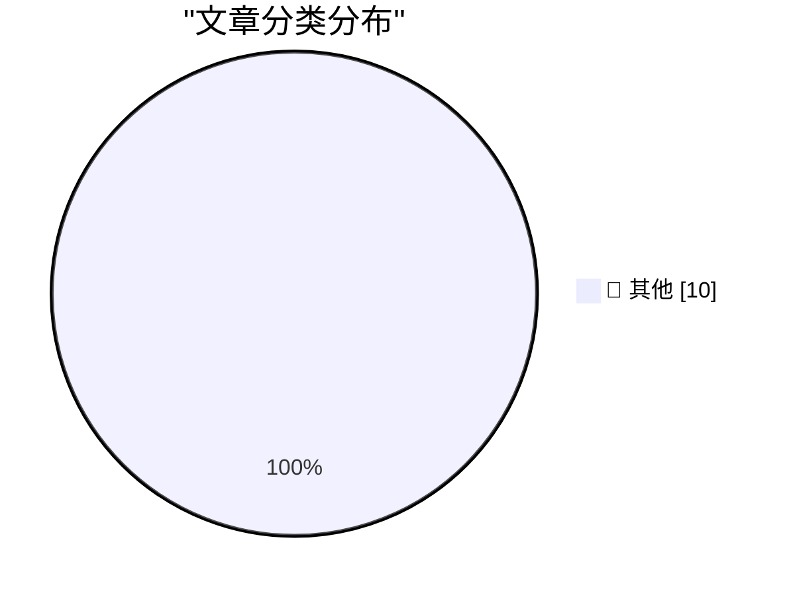

# 📰 AI 博客每日精选 — 2026-03-24

> 来自 Karpathy 推荐的 92 个顶级技术博客，AI 精选 Top 10

## 📝 今日看点

<think>
用户要求我根据今日技术文章列表写一段"今日看点"总结，要求提炼2-3个主要趋势或话题，宏观归纳，简洁有力。

让我分析这些文章标题：
1. Quoting Neurotica — 引用
2. datasette-files 0.1a2 — datasette工具的更新
3. Quoting David Abram — 引用
4. Beats now have notes — 音乐/音频工具更新
5. Starlette 1.0 skill — Starlette框架
6. Experimenting with Starlette 1.0 with Claude skills — Starlette + AI
7. PCGamer Article Performance Audit — 性能审计
8. JavaScript Sandboxing Research — JavaScript沙箱研究
9. DNS Lookup — DNS相关
10. Merge State Visualizer — 可视化工具

看起来主要趋势：
1. Web框架 - Starlette 1.0相关的开发和实验
2. 开发工具/可视化 - datasette-files, Merge State Visualizer
3. 安全/沙箱 - JavaScript Sandboxing Research
4. 性能优化 - PCGamer Article Performance Audit

这些标题看起来比较零散，但我需要从中提炼主要趋势。我看到Starlette出现了两次（5和6），这可能是一个重点。JavaScript沙箱研究也是技术安全问题。开发工具和数据处理也有涉及。

让我写一个简洁的总结：

技术圈聚焦于Web框架的迭代和安全研究。Starlette 1.0的发布引发开发者社区深入实验，探索与AI技能的融合。同时，JavaScript沙箱技术成为安全领域的关注焦点，反映出对代码隔离和防护的持续重视。开发工具的创新，如datasette和Merge State Visualizer，体现了技术生态系统对效率和可视化的追求。
</think>

今日技术圈聚焦于Web框架的迭代与安全研究。Starlette 1.0发布引发开发者社区深入实验，探索其与AI能力的结合应用。同时，JavaScript沙箱技术成为安全领域的关注焦点，反映出对代码隔离和防护的持续重视。开发工具层面，数据处理与状态可视化相关项目持续推进，展现技术生态对效率提升的追求。

---

## 🏆 今日必读

🥇 **Quoting Neurotica**

[Quoting Neurotica](https://simonwillison.net/2026/Mar/23/neurotica/#atom-everything) — simonwillison.net · 2 小时前 · 📝 其他

> Quoting Neurotica

🥈 **datasette-files 0.1a2**

[datasette-files 0.1a2](https://simonwillison.net/2026/Mar/23/datasette-files/#atom-everything) — simonwillison.net · 3 小时前 · 📝 其他

> datasette-files 0.1a2

🥉 **Quoting David Abram**

[Quoting David Abram](https://simonwillison.net/2026/Mar/23/david-abram/#atom-everything) — simonwillison.net · 7 小时前 · 📝 其他

> Quoting David Abram

---

## 📊 数据概览

| 扫描源 | 抓取文章 | 时间范围 | 精选 |
|:---:|:---:|:---:|:---:|
| 86/92 | 2471 篇 → 31 篇 | 48h | **10 篇** |

### 分类分布

---

## 📝 其他

### 1. Quoting Neurotica

[Quoting Neurotica](https://simonwillison.net/2026/Mar/23/neurotica/#atom-everything) — **simonwillison.net** · 2 小时前 · ⭐ 15/30

> Quoting Neurotica

---

### 2. datasette-files 0.1a2

[datasette-files 0.1a2](https://simonwillison.net/2026/Mar/23/datasette-files/#atom-everything) — **simonwillison.net** · 3 小时前 · ⭐ 15/30

> datasette-files 0.1a2

---

### 3. Quoting David Abram

[Quoting David Abram](https://simonwillison.net/2026/Mar/23/david-abram/#atom-everything) — **simonwillison.net** · 7 小时前 · ⭐ 15/30

> Quoting David Abram

---

### 4. Beats now have notes

[Beats now have notes](https://simonwillison.net/2026/Mar/23/beats-now-have-notes/#atom-everything) — **simonwillison.net** · 1 天前 · ⭐ 15/30

> Beats now have notes

---

### 5. Starlette 1.0 skill

[Starlette 1.0 skill](https://simonwillison.net/2026/Mar/23/starlette-1-skill/#atom-everything) — **simonwillison.net** · 1 天前 · ⭐ 15/30

> Starlette 1.0 skill

---

### 6. Experimenting with Starlette 1.0 with Claude skills

[Experimenting with Starlette 1.0 with Claude skills](https://simonwillison.net/2026/Mar/22/starlette/#atom-everything) — **simonwillison.net** · 1 天前 · ⭐ 15/30

> Experimenting with Starlette 1.0 with Claude skills

---

### 7. PCGamer Article Performance Audit

[PCGamer Article Performance Audit](https://simonwillison.net/2026/Mar/22/pcgamer-audit/#atom-everything) — **simonwillison.net** · 1 天前 · ⭐ 15/30

> PCGamer Article Performance Audit

---

### 8. JavaScript Sandboxing Research

[JavaScript Sandboxing Research](https://simonwillison.net/2026/Mar/22/javascript-sandboxing-research/#atom-everything) — **simonwillison.net** · 1 天前 · ⭐ 15/30

> JavaScript Sandboxing Research

---

### 9. DNS Lookup

[DNS Lookup](https://simonwillison.net/2026/Mar/22/dns/#atom-everything) — **simonwillison.net** · 1 天前 · ⭐ 15/30

> DNS Lookup

---

### 10. Merge State Visualizer

[Merge State Visualizer](https://simonwillison.net/2026/Mar/22/manyana/#atom-everything) — **simonwillison.net** · 1 天前 · ⭐ 15/30

> Merge State Visualizer

---

*生成于 2026-03-24 02:20 | 扫描 86 源 → 获取 2471 篇 → 精选 10 篇*
*基于 [Hacker News Popularity Contest 2025](https://refactoringenglish.com/tools/hn-popularity/) RSS 源列表，由 [Andrej Karpathy](https://x.com/karpathy) 推荐*
*由「懂点儿AI」制作，欢迎关注同名微信公众号获取更多 AI 实用技巧 💡*
