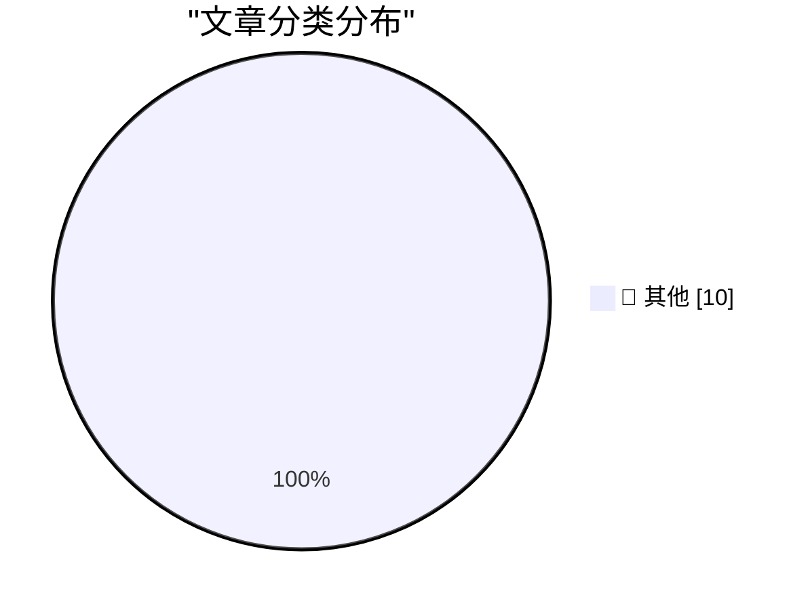

# 📰 AI 博客每日精选 — 2026-03-27

> 来自 Karpathy 推荐的 92 个顶级技术博客，AI 精选 Top 10

## 🏆 今日必读

🥇 **We Rewrote JSONata with AI in a Day, Saved $500K/Year**

[We Rewrote JSONata with AI in a Day, Saved $500K/Year](https://simonwillison.net/2026/Mar/27/vine-porting-jsonata/#atom-everything) — simonwillison.net · 1 小时前 · 📝 其他

> We Rewrote JSONata with AI in a Day, Saved $500K/Year

🥈 **My minute-by-minute response to the LiteLLM malware attack**

[My minute-by-minute response to the LiteLLM malware attack](https://simonwillison.net/2026/Mar/26/response-to-the-litellm-malware-attack/#atom-everything) — simonwillison.net · 2 小时前 · 📝 其他

> My minute-by-minute response to the LiteLLM malware attack

🥉 **Quantization from the ground up**

[Quantization from the ground up](https://simonwillison.net/2026/Mar/26/quantization-from-the-ground-up/#atom-everything) — simonwillison.net · 9 小时前 · 📝 其他

> Quantization from the ground up

---

## 📊 数据概览

| 扫描源 | 抓取文章 | 时间范围 | 精选 |
|:---:|:---:|:---:|:---:|
| 84/92 | 2438 篇 → 35 篇 | 48h | **10 篇** |

### 分类分布

---

## 📝 其他

### 1. We Rewrote JSONata with AI in a Day, Saved $500K/Year

[We Rewrote JSONata with AI in a Day, Saved $500K/Year](https://simonwillison.net/2026/Mar/27/vine-porting-jsonata/#atom-everything) — **simonwillison.net** · 1 小时前 · ⭐ 15/30

> We Rewrote JSONata with AI in a Day, Saved $500K/Year

---

### 2. My minute-by-minute response to the LiteLLM malware attack

[My minute-by-minute response to the LiteLLM malware attack](https://simonwillison.net/2026/Mar/26/response-to-the-litellm-malware-attack/#atom-everything) — **simonwillison.net** · 2 小时前 · ⭐ 15/30

> My minute-by-minute response to the LiteLLM malware attack

---

### 3. Quantization from the ground up

[Quantization from the ground up](https://simonwillison.net/2026/Mar/26/quantization-from-the-ground-up/#atom-everything) — **simonwillison.net** · 9 小时前 · ⭐ 15/30

> Quantization from the ground up

---

### 4. datasette-files-s3 0.1a1

[datasette-files-s3 0.1a1](https://simonwillison.net/2026/Mar/25/datasette-files-s3/#atom-everything) — **simonwillison.net** · 1 天前 · ⭐ 15/30

> datasette-files-s3 0.1a1

---

### 5. Thoughts on slowing the fuck down

[Thoughts on slowing the fuck down](https://simonwillison.net/2026/Mar/25/thoughts-on-slowing-the-fuck-down/#atom-everything) — **simonwillison.net** · 1 天前 · ⭐ 15/30

> Thoughts on slowing the fuck down

---

### 6. datasette-llm 0.1a1

[datasette-llm 0.1a1](https://simonwillison.net/2026/Mar/25/datasette-llm/#atom-everything) — **simonwillison.net** · 1 天前 · ⭐ 15/30

> datasette-llm 0.1a1

---

### 7. LiteLLM Hack: Were You One of the 47,000?

[LiteLLM Hack: Were You One of the 47,000?](https://simonwillison.net/2026/Mar/25/litellm-hack/#atom-everything) — **simonwillison.net** · 1 天前 · ⭐ 15/30

> LiteLLM Hack: Were You One of the 47,000?

---

### 8. Engineers do get promoted for writing simple code

[Engineers do get promoted for writing simple code](https://seangoedecke.com/simple-work-gets-rewarded/) — **seangoedecke.com** · 1 天前 · ⭐ 15/30

> Engineers do get promoted for writing simple code

---

### 9. Apple Discontinues the Mac Pro With No Plans to Bring It Back

[Apple Discontinues the Mac Pro With No Plans to Bring It Back](https://9to5mac.com/2026/03/26/apple-discontinues-the-mac-pro/) — **daringfireball.net** · 1 小时前 · ⭐ 15/30

> Apple Discontinues the Mac Pro With No Plans to Bring It Back

---

### 10. The Apple Charging Situation

[The Apple Charging Situation](https://randsinrepose.com/guides/apple-charging-guide.html) — **daringfireball.net** · 5 小时前 · ⭐ 15/30

> The Apple Charging Situation

---

*生成于 2026-03-27 02:17 | 扫描 84 源 → 获取 2438 篇 → 精选 10 篇*
*基于 [Hacker News Popularity Contest 2025](https://refactoringenglish.com/tools/hn-popularity/) RSS 源列表，由 [Andrej Karpathy](https://x.com/karpathy) 推荐*
*由「懂点儿AI」制作，欢迎关注同名微信公众号获取更多 AI 实用技巧 💡*
