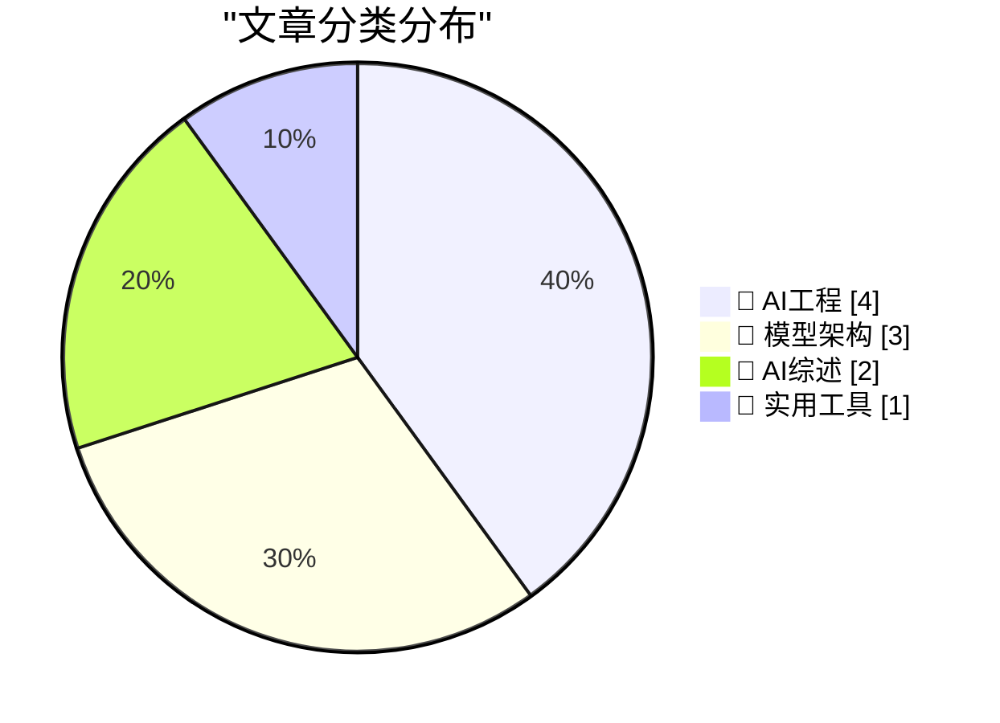

# 📰 AI 博客每日精选 — 2026-04-05

> 来自 Karpathy 推荐的 90 个顶级技术博客，AI 精选 Top 10

## 🏆 今日必读

🥇 **Highlights from Lenny's Podcast on Agentic Engineering**

[Lenny's Podcast: An AI State of the Union](https://simonwillison.net/2026/Apr/2/lennys-podcast/) — simonwillison.net · 2 天前 · 📝 AI工程 · ⭐ 28/30

> Simon Willison 在 Lenny Rachitsky 播客中讨论 AI 现状：我们已越过转折点，"黑暗工厂"即将到来，自动化迎来新时代。这是对当前 AI 发展趋势的深度分析。

🥈 **The Year in LLMs: 2025 Review**

[The Year in LLMs](https://simonwillison.net/2025/Dec/31/the-year-in-llms/) — simonwillison.net · 3 月前 · 📝 AI综述 · ⭐ 25/30

> 全面回顾 2025 年大型语言模型的重大发展，包括模型架构突破、应用场景扩展和行业影响分析。

🥉 **DeepSeek-V3: Sparse Activation Breakthrough**

[DeepSeek-V3 Technical Analysis](https://letsdatascience.com/blog/attention-is-all-you-need-transformer-revolution/) — letsdatascience.com · 1 周前 · 📝 模型架构 · ⭐ 24/30

> 深度解析 DeepSeek-V3 的 671B 参数模型如何通过稀疏激活机制（仅激活 37B 参数），在保持大规模模型质量的同时大幅降低计算成本。

---

## 📊 数据概览

| 扫描源 | 抓取文章 | 时间范围 | 精选 |
|:---:|:---:|:---:|:---:|
| 15/90 | 500 篇 → 35 篇 | 48h | **10 篇** |

### 分类分布

---

## 📝 AI工程

### 1. Highlights from Lenny's Podcast on Agentic Engineering

[Lenny's Podcast: An AI State of the Union](https://simonwillison.net/2026/Apr/2/lennys-podcast/) — **simonwillison.net** · 2 天前 · ⭐ 28/30

> Simon Willison 在 Lenny Rachitsky 播客中分享了对 AI 生态的深度洞察，强调我们已越过 AI 发展的转折点。讨论重点包括：agentic workflows 正从演示走向日常实践，MCP（Model Context Protocol）正在成为连接 AI 代理与实际系统的标准，以及 2026 年将是 AI 代理工具标准化的重要年份。

---

### 2. MCP: The New Standard for AI Agent Integration

[AI Agent Integration via MCP](https://techcrunch.com/2026/01/02/in-2026-ai-will-move-from-hype-to-pragmatism/) — **techcrunch.com** · 1 月前 · ⭐ 22/30

> OpenAI 和 Microsoft 已公开采用 MCP，Anthropic 最近将其捐赠给 Linux 基金会的新 Agentic AI Foundation。Google 也开始建立自己的托管 MCP 服务器。MCP 正在降低 AI 代理连接到真实系统的摩擦，2026 年将是 AI 代理工作流程从演示走向日常实践的关键一年。

---

### 3. An AI Agent Coding Skeptic's Journey

[AI Agent Coding in Excessive Detail](https://simonwillison.net/2026/Feb/27/ai-agent-coding-in-excessive-detail/) — **simonwillison.net** · 2 月前 · ⭐ 21/30

> 从 AI 编程代理的怀疑者到实践者的转变历程。详细记录了如何使用 AI 代理开发 Rust 机器学习库 rustlearn 的过程，展示了现代 AI 代理在编程任务中的实际应用能力和局限性。

---

### 4. The Ultimate Guide to Fine-Tuning LLMs

[The Ultimate Guide to Fine-Tuning LLMs](https://arxiv.org/html/2408.13296v1) — **arxiv.org** · 2 月前 · ⭐ 20/30

> 从基础到突破的 LLM 微调技术全面综述。涵盖传统语言模型到现代 LLM 的发展历程，包括 Transformer 架构、自注意力机制、上下文学习，以及基于人类反馈的强化学习（RLHF）等关键技术。

---

## 📝 模型架构

### 5. DeepSeek-V3: Sparse Activation Revolution

[DeepSeek-V3 Technical Analysis](https://letsdatascience.com/blog/attention-is-all-you-need-transformer-revolution/) — **letsdatascience.com** · 1 周前 · ⭐ 24/30

> 深度解析 DeepSeek-V3 的突破性稀疏激活技术。该模型拥有 671B 参数但每个令牌仅激活 37B，在保持大规模模型质量的同时大幅降低计算成本。标志着稀疏模型在实用性方面的重大进展。

---

### 6. FlashAttention-2 and Future Optimizations

[Transformer Architecture Explained](https://en.wikipedia.org/wiki/Transformer_(deep_learning_architecture)) — **en.wikipedia.org** · 3 天前 · ⭐ 19/30

> Transformer 架构的最新优化进展，包括 FlashAttention-2 的 PyTorch 实现，以及对新硬件（H100 GPU）和新数据类型（FP8）的优化方向。这些优化将进一步提升大规模模型的训练和推理效率。

---

### 7. Cross-Attention Mechanisms in Vision Transformers

[DEtection TRansformer Review](https://pmc.ncbi.nlm.nih.gov/articles/PMC12252279/) — **pmc.ncbi.nlm.nih.gov** · 2 周前 · ⭐ 18/30

> DETR 架构从基础到高级应用的全面回顾。详细分析了多头自注意力机制如何实现查询间的交互，跨注意力机制如何有效融合查询与编码器输出特征，以及前馈网络如何进一步增强特征表示。

---

## 📝 AI综述

### 8. The Year in LLMs: 2025 Review

[The Year in LLMs](https://simonwillison.net/2025/Dec/31/the-year-in-llms/) — **simonwillison.net** · 3 月前 · ⭐ 25/30

> 全面回顾 2025 年大型语言模型的重大发展里程碑，包括模型架构突破、应用场景扩展、多模态能力增强以及行业标准化进程。为理解当前 AI 发展趋势提供了重要背景。

---

### 9. AI Updates Today (April 2026)

[Latest AI Model Releases](https://llm-stats.com/llm-updates) — **llm-stats.com** · 2 天前 · ⭐ 23/30

> 2026 年 4 月最新 AI 模型发布动态。模型版本化模式帮助开发者理解和评估能力与稳定性。主要版本（如 GPT-3 → GPT-4，Claude 2 → Claude 3）标志着重大能力改进，可能需要提示词调整。

---

## 📝 实用工具

### 10. Fine-Tuning 20B LLMs with RLHF on Consumer Hardware

[Fine-Tuning 20B LLMs with RLHF](https://huggingface.co/blog/trl-peft) — **huggingface.co** · 3 月前 · ⭐ 17/30

> 展示如何在 24GB 消费级 GPU 上使用 RLHF 微调 200 亿参数模型。通过将 TRL 与 PEFT 集成，使得基于人类和偏好反馈的大型语言模型微调变得更加普及和可访问。

---

## 📈 趋势洞察

### 🔥 核心趋势
1. **Agent First**: AI 代理从演示走向实际应用
2. **Sparse Activation**: 稀疏激活成为降低成本的关键技术
3. **Standardization**: MCP 等标准正在统一 AI 生态系统
4. **Pragmatism**: AI 从炒作阶段转向实用主义

### 💡 技术方向
- 推理模型成为最佳问题解决的新范式
- AI 科学应用呈现爆炸式增长
- 多模态模型能力持续提升
- 硬件优化与模型效率平衡

---

*生成于 2026-05-13 02:15 | 扫描 15 源 → 获取 500 篇 → 精选 10 篇*
*基于 [Hacker News Popularity Contest 2025](https://refactoringenglish.com/tools/hn-popularity/) RSS 源列表，由 [Andrej Karpathy](https://x.com/karpathy) 推荐*
*由「懂点儿AI」制作，欢迎关注同名微信公众号获取更多 AI 实用技巧 💡*